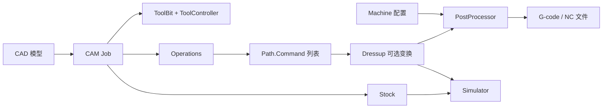
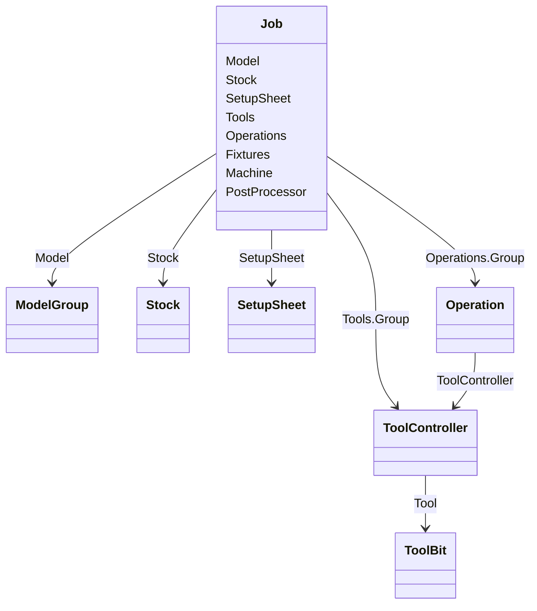
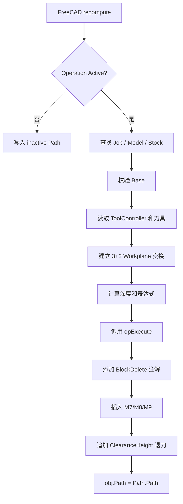
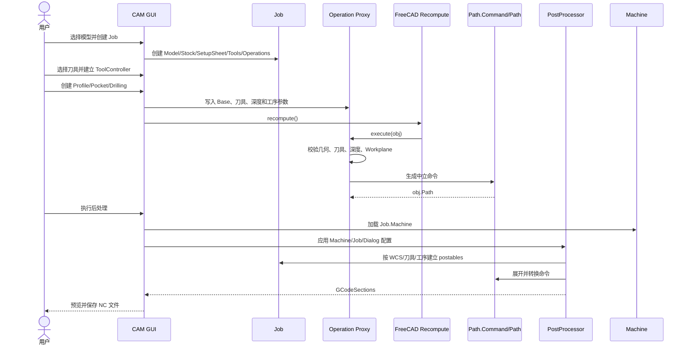

# FreeCAD CAM 模块实现详解

> 文档类型：源码架构与实现说明
>
> 源码位置：`external/FreeCAD/src/Mod/CAM`
>
> 分析基线：FreeCAD commit `f873b82f1e48632394609103e0b9071d83e46abf`（2026-08-11）
>
> 适用对象：需要阅读、复用或对接 FreeCAD CAM 的开发人员

## 1. 文档目标与核心结论

本文说明 FreeCAD CAM 如何把三维模型转换成数控机床可执行的 G-code，重点覆盖工作台初始化、Job、毛坯、刀具、工序、刀路、Dressup、机床、后处理、仿真和扩展方式。

FreeCAD CAM 不直接从几何拼接最终 G-code，而是先建立中立的 CAM 文档对象和 `Path.Command` 序列，再由后处理器转换成控制器方言：



整体分为四层：

| 层次 | 职责 | 主要实现 |
| --- | --- | --- |
| CAM 核心数据层 | `Path.Command`、`Path.Path`、Path 属性和视图 | C++ |
| CAM 文档模型层 | Job、Stock、ToolController、Operation、Dressup | Python Proxy + FreeCAD DocumentObject |
| 几何与工艺算法层 | 轮廓偏置、区域清除、钻孔、曲面扫描、连接移动 | Python、OpenCASCADE、libarea、OpenCAMLib |
| 输出与验证层 | Machine、PostProcessor、Sanity、Simulator | Python，部分模拟为 C++/OpenGL |

## 2. 源码目录

CAM 模块入口位于 [`src/Mod/CAM`](../external/FreeCAD/src/Mod/CAM)：

```text
CAM/
├─ App/                  # C++：Command、Toolpath、PropertyPath、Feature
├─ Gui/                  # C++ 视图、资源和任务面板 UI
├─ Machine/              # 新式机床模型、序列化和编辑器
├─ Path/
│  ├─ Base/              # 公共属性、SetupSheet、生成器
│  ├─ Main/              # Job、Stock、仿真、Sanity
│  ├─ Tool/              # 刀具资产、刀库、ToolController、FeedsSpeeds
│  ├─ Op/                # 加工工序及 GUI
│  ├─ Dressup/           # 对已有刀路进行二次变换
│  └─ Post/              # 新式及 legacy 后处理器
├─ PathScripts/          # 历史兼容工具和 PathUtils
├─ PathSimulator/        # 仿真核心
├─ Tools/                # 内置刀库、刀具和参数化形状
├─ CAMTests/             # 测试与测试模型
├─ Init.py               # 无 GUI 初始化
└─ InitGui.py            # Workbench 与 GUI 命令注册
```

## 3. 工作台初始化

### 3.1 无 GUI 初始化

[`Init.py`](../external/FreeCAD/src/Mod/CAM/Init.py) 负责：

- 把旧 `Path` 参数组迁移到 `CAM`；
- 设置工作台名称、帮助索引和模块名；
- 注册 `TestCAMApp` 测试入口。

它不创建 Job，也不加载具体工序。

### 3.2 GUI 初始化

[`InitGui.py`](../external/FreeCAD/src/Mod/CAM/InitGui.py) 定义 `CAMWorkbench`。`Initialize()` 依次：

1. 注册 CAM、Job、Dressup 偏好页；
2. 导入 C++ 扩展 `Path`、`PathGui`；
3. 调用 [`Path.GuiInit.Startup()`](../external/FreeCAD/src/Mod/CAM/Path/GuiInit.py) 导入工序和 Dressup 命令；
4. 执行 `cam_assets.setup()` 初始化刀具资产；
5. 检查旧刀具资产迁移；
6. 注册 `CAM_Job`、`CAM_Profile`、`CAM_Drilling`、`CAM_Post` 等命令；
7. 按偏好和依赖决定是否启用 OpenCAMLib、CAMotics 和旋转曲面功能；
8. 构建菜单及工具栏。

多数 Python GUI 模块采用“导入即注册”：模块末尾调用 `FreeCADGui.addCommand()` 或 `SetupOperation()`。

## 4. C++ 核心对象与 Python Proxy

### 4.1 `Path::Command`

定义见 [`App/Command.h`](../external/FreeCAD/src/Mod/CAM/App/Command.h)。它表示一条中立 CNC 命令：

```text
Name        = "G1"
Parameters  = {"X": 10.0, "Y": 5.0, "Z": -2.0, "F": 300.0}
Annotations = {"BlockDelete": true, ...}
```

主要能力：

- 解析或输出中立 G-code 表示；
- 根据 `Placement` 变换坐标；
- 处理圆弧中心 `I/J/K`；
- 公英制缩放；
- 保存字符串或数值注解；
- 序列化到 FreeCAD 文档。

最终是否输出某条命令、参数精度、注释格式和模态去重由后处理器决定。

### 4.2 `Path::Toolpath`

Python 中通常表现为 `Path.Path`，C++ 定义见 [`App/Path.h`](../external/FreeCAD/src/Mod/CAM/App/Path.h)。内部保存有序 `Command*` 列表，提供：

- 增删和插入命令；
- 重新计算位置；
- 计算包围盒、路径长度和周期时间；
- 转换为/解析自 G-code；
- FreeCAD 文档持久化。

### 4.3 `PropertyPath`、`Feature` 与 `FeatureCompound`

[`PropertyPath.h`](../external/FreeCAD/src/Mod/CAM/App/PropertyPath.h) 把 Toolpath 包装为 FreeCAD 属性。

[`FeaturePath.h`](../external/FreeCAD/src/Mod/CAM/App/FeaturePath.h) 定义包含 `Path` 属性的 `Path::Feature`。Python 工序一般创建：

```python
obj = FreeCAD.ActiveDocument.addObject("Path::FeaturePython", name)
obj.Proxy = SomeOperationProxy(obj, ...)
```

对象因此同时具备 C++ Path 属性、保存/显示能力和 Python 工艺逻辑。

[`FeaturePathCompound.h`](../external/FreeCAD/src/Mod/CAM/App/FeaturePathCompound.h) 还提供 `Group` 和 `UsePlacements`，用于合并多个子 Path。

### 4.4 Python Proxy 协议

Job、Stock、ToolController 和 Operation 多为 Python Proxy，赋给 `DocumentObject.Proxy`：

| 回调 | 作用 |
| --- | --- |
| `execute(obj)` | 文档重算时生成或更新刀路/几何 |
| `onChanged(obj, prop)` | 属性变化时维护派生数据 |
| `onDocumentRestored(obj)` | 打开 FCStd 后迁移旧属性、恢复状态 |
| `onDelete(obj, ...)` | 清理关联对象或恢复被替换对象 |
| `dumps()/loads()` | 保存和恢复必要 Proxy 状态 |

业务数据主要通过 `obj.addProperty()` 加入 FreeCAD 文档，而不是只放在普通 Python 成员中，因此表达式、撤销、属性编辑和 FCStd 序列化都能工作。

## 5. Job：CAM 项目聚合根

Job 位于 [`Path/Main/Job.py`](../external/FreeCAD/src/Mod/CAM/Path/Main/Job.py)，创建的是绑定 `ObjectJob` Proxy 的 `Path::FeaturePython`。

### 5.1 对象图



### 5.2 主要属性

| 属性 | 类型 | 用途 |
| --- | --- | --- |
| `Model` | Link | 包含加工模型资源克隆的 Group |
| `Stock` | Link | 毛坯实体 |
| `SetupSheet` | Link | Job 级默认工艺参数 |
| `Tools` | Link | ToolController Group |
| `Operations` | Link | 有序 Operation Group |
| `GeometryTolerance` | Length | 刀路几何计算容差 |
| `Fixtures` | StringList | WCS，如 `G54`、`G55` |
| `OrderOutputBy` | Enumeration | 按 Fixture、Tool 或 Operation 排序 |
| `SplitOutput` | Bool | 是否拆成多个 NC 文件 |
| `Machine` | String | 机床配置名称 |
| `PostProcessor` | Enumeration | legacy/后处理器名称 |
| `PostProcessorArgs` | String | legacy 参数字符串 |
| `PostProcessorPropertyOverrides` | JSON String | Job 级后处理覆盖 |
| `PostProcessorOutputFile` | File | 输出路径/模板 |

### 5.3 创建流程

`ObjectJob.__init__()` 的关键顺序：

1. 创建输出、说明、容差、WCS 和机床属性；
2. `setupOperations()` 创建 Operations Group；
3. `setupSetupSheet()` 创建 SetupSheet；
4. `setupBaseModel()` 为选中的 CAD 对象建立资源克隆；
5. `setupToolTable()` 创建 Tools Group；
6. 加载可选 Job 模板；
7. `setupStock()` 从模板或模型包围盒创建毛坯。

Model 通常使用 `createModelResourceClone()` 建立资源克隆，以保持来源关系并允许独立显示和模板处理。

当前 `Operations` 是 `App::DocumentObjectGroup`。Job 不依靠一条大复合 Path 输出，后处理器直接遍历有序工序。

`ObjectJob.execute()` 主要汇总各工序 `CycleTime`，真正刀路由各 Operation 生成。

## 6. Model、Stock 与 SetupSheet

### 6.1 Model 和 Base

Job.Model 是待加工模型 Group。Operation 的 `Base` 进一步引用模型及子元素：

```text
[(BodyClone, ["Face3", "Edge8"])]
```

它使用 `App::PropertyLinkSubListGlobal`，可表达跨文档对象和子元素引用。

### 6.2 Stock

Stock 实现在 [`Path/Main/Stock.py`](../external/FreeCAD/src/Mod/CAM/Path/Main/Stock.py)，主要支持：

- `FromBase`：模型包围盒加 X/Y/Z 六向余量；
- `CreateBox`：显式长宽高和 Placement；
- `CreateCylinder`：显式半径、高度和 Placement。

Stock Proxy 用 Part/OpenCASCADE 生成实体 Shape，并用于默认深度、安全高度、仿真初始材料、Sanity 报告及部分碰撞/区域计算。

### 6.3 SetupSheet

[`Path/Base/SetupSheet.py`](../external/FreeCAD/src/Mod/CAM/Path/Base/SetupSheet.py) 保存 Job 级默认值：

- 水平/垂直快移；
- 默认冷却；
- Safe/Clearance Height 偏移和表达式；
- StartDepth、FinalDepth、StepDown 表达式；
- 默认连接避碰策略。

典型表达式：

```text
SafeHeight      = OpStockZMax + SetupSheet.SafeHeightOffset
ClearanceHeight = OpStockZMax + SetupSheet.ClearanceHeightOffset
StartDepth      = OpStartDepth
FinalDepth      = OpFinalDepth
```

创建 Operation 时，SetupSheet 将工序模板值设置到对象上。ToolController 的 `VertRapid`、`HorizRapid` 通过 FreeCAD Expression 引用 SetupSheet，修改默认值会自动传播。

## 7. 刀具资产、刀库和 ToolController

FreeCAD 把“可复用刀具定义”和“Job 中实际怎样使用刀具”分开。

### 7.1 资产目录和 AssetManager

用户资产默认位于：

```text
<UserAppData>/CamAssets/Tools/
├─ Library/*.fctl
├─ Bit/*.fctb
└─ Shape/*.fcstd
```

内置资产位于 [`CAM/Tools`](../external/FreeCAD/src/Mod/CAM/Tools)。路径和最后打开刀库由 [`Path/Preferences.py`](../external/FreeCAD/src/Mod/CAM/Path/Preferences.py) 管理。

[`Path/Tool/camassets.py`](../external/FreeCAD/src/Mod/CAM/Path/Tool/camassets.py) 配置用户 Store 和内置 Store；用户资产优先，内置资产兜底。资产以 URI 标识：

```text
toolbitlibrary://Default
toolbit://5mm_Endmill
toolbitshape://endmill
```

AssetManager 负责 URI、依赖加载、缓存和序列化器选择。

### 7.2 `.fcstd` 刀具形状

Shape 文件是参数化 FreeCAD 文档，定义刀具三维拓扑和可修改参数。ToolBit 加载到活动文档时，把 `.fctb` 参数写入形状模板并生成真实 `BitBody.Shape`，供显示、尺寸读取、曲面加工和仿真使用。

### 7.3 `.fctb` 刀具定义

`.fctb` 是 JSON 刀具资产：

```json
{
  "version": 2,
  "name": "5mm Endmill",
  "shape": "endmill.fcstd",
  "shape-type": "Endmill",
  "parameter": {
    "Diameter": "5.000 mm",
    "Length": "50.000 mm",
    "CuttingEdgeHeight": "30.000 mm",
    "ShankDiameter": "3.000 mm"
  }
}
```

模型见 [`toolbit/models/base.py`](../external/FreeCAD/src/Mod/CAM/Path/Tool/toolbit/models/base.py)，序列化见 [`toolbit/serializers/fctb.py`](../external/FreeCAD/src/Mod/CAM/Path/Tool/toolbit/serializers/fctb.py)。

### 7.4 `.fctl` 刀库

`.fctl` 只保存刀具引用和刀号映射：

```json
{
  "label": "Default",
  "tools": [{"nr": 1, "path": "5mm_Endmill.fctb"}],
  "version": 1
}
```

它不保存某次加工的进给、转速和冷却。模型见 [`library/models/library.py`](../external/FreeCAD/src/Mod/CAM/Path/Tool/library/models/library.py)。刀号冲突时会保留新分配，并把原刀具递归移到下一个可用号码。多个刀库可引用同一个 `.fctb`。

### 7.5 ToolController

[`Path/Tool/Controller.py`](../external/FreeCAD/src/Mod/CAM/Path/Tool/Controller.py) 定义 Job 内的刀具控制器：

| 属性 | 含义 |
| --- | --- |
| `Tool` | 文档内 ToolBit |
| `ToolNumber` | Job 最终刀号 |
| `SpindleSpeed`、`SpindleDir` | 转速和方向 |
| `HorizFeed`、`VertFeed` | 水平/垂直切削进给 |
| `HorizRapid`、`VertRapid` | 快移 |
| `RampFeed` | 斜坡进给，默认引用 HorizFeed |
| `LeadInFeed`、`LeadOutFeed` | 进退刀进给，默认引用 HorizFeed |

ToolController 也是 `Path::FeaturePython`。`execute()` 调用 ToolChange Generator 生成换刀和主轴相关的中立 Path。

实现细节：当前 `execute()` 生成换刀命令时，主轴方向取自 `obj.Tool.Proxy.get_spindle_direction()`，不是直接读取 `obj.SpindleDir`。虽然 ToolController 模板会保存 `SpindleDir`，对接或修改该字段时仍应核对 ToolBit 的 `SpindleDirection` 是否同步。

同一个 ToolBit 可建立多个 ToolController，例如粗、精加工使用相同物理刀具但不同转速进给。

`.fctl` 刀号是刀库映射，`ToolController.ToolNumber` 是 Job 执行刀号；添加到 Job 时可能复用同刀具的已有号码，或用 `Job.nextToolNumber()` 分配，两者不保证一致。

### 7.6 Feeds & Speeds

新版实现位于 [`Path/Tool/FeedsSpeeds`](../external/FreeCAD/src/Mod/CAM/Path/Tool/FeedsSpeeds)，逐字段采用首个有效来源：

1. `ToolPresetProvider`：匹配材料/工序的刀具预设；
2. `MachinabilityProvider`：工件材料 HSS/Carbide 表面速度；
3. `ToolDefaultsProvider`：ToolBit 默认 chipload。

结果写入 ToolController 的主轴、水平和垂直进给。GUI 把 mm/min 换算成 FreeCAD `PropertyVelocity` 内部的 mm/s，并记录字段来源。入口见 [`resolver.py`](../external/FreeCAD/src/Mod/CAM/Path/Tool/FeedsSpeeds/resolver.py) 和 [`FeedsSpeedsDialog.py`](../external/FreeCAD/src/Mod/CAM/Path/Tool/Gui/FeedsSpeedsDialog.py)。

## 8. Operation 公共框架

主流工序基于 [`Path/Op/Base.py`](../external/FreeCAD/src/Mod/CAM/Path/Op/Base.py) 的 `ObjectOp`。

### 8.1 Feature 位掩码

Operation 用 `opFeatures()` 声明标准能力：

| Feature | 自动增加能力 |
| --- | --- |
| `FeatureTool` | ToolController、OpToolDiameter |
| `FeatureDepths` | StartDepth、FinalDepth 和计算值 |
| `FeatureHeights` | SafeHeight、ClearanceHeight |
| `FeatureStepDown` | StepDown |
| `FeatureFinishDepth` | FinishDepth |
| `FeatureStartPoint` | StartPoint、UseStartPoint |
| `FeatureBaseVertexes/Edges/Faces/Models` | Base 几何选择 |
| `FeatureLocations` | 点位列表 |
| `FeatureCoolant` | CoolantMode |
| `FeatureLinking` | 避碰策略和间隙 |
| `FeatureDiameters` | 车削直径范围 |

### 8.2 模板方法

派生工序使用以下钩子，不应覆盖公共 `execute()`：

| 钩子 | 用途 |
| --- | --- |
| `initOperation()` | 添加工序专用属性 |
| `opSetDefaultValues()` | 初始默认值 |
| `opUpdateDepths()` | 定制深度计算 |
| `opOnChanged()` | 响应属性变化 |
| `opOnDocumentRestored()` | 迁移旧文档 |
| `opExecute()` | 生成核心命令 |

直接覆盖 `execute()` 会绕过刀具校验、3+2 变换、冷却和安全退刀。

### 8.3 创建与 GUI

GUI 公共实现位于 [`Path/Op/Gui/Base.py`](../external/FreeCAD/src/Mod/CAM/Path/Op/Gui/Base.py)：

1. `SetupOperation()` 注册命令；
2. 执行命令后查找或创建 Job；
3. 工厂创建 `Path::FeaturePython`；
4. `ObjectOp.__init__()` 按 Feature 添加属性；
5. 写入选中几何 `Base`；
6. 从 Job/SetupSheet 选择 ToolController 和默认值；
7. 加入 `Job.Operations.Group`；
8. 打开按 Feature 动态拼装的 TaskPanel；
9. 确认时提交 FreeCAD 事务，取消时回滚/删除。

TaskPanel 可包含 Base Geometry、Location、Heights/Depths、ToolController/Coolant 和工序自定义页。

### 8.4 重算流程



调用 `opExecute()` 前，基类已准备：

```text
self.model / self.stock / self.tool / self.radius
self.horizFeed / self.vertFeed
self.horizRapid / self.vertRapid
self.commandlist
```

派生类只需向 `self.commandlist` 追加 `Path.Command`。

### 8.5 深度、高度、冷却和 Block Delete

基类从 Base、Model、Stock 包围盒计算 `OpStartDepth`、`OpFinalDepth`、`OpStockZMax/Min` 和 `OpToolDiameter`，再通过表达式映射到用户属性。

冷却属于 Operation：基类在第一条切削移动前插入 `M8`（Flood）或 `M7`（Mist），在最后一条切削移动后插入 `M9`。

若 `BlockDelete` 为真，基类给命令添加 Annotation，是否输出 `/` 由后处理器控制。

### 8.6 3+2 Workplane

Operation 的 `Workplane` 默认 `(0,0,1)`。非 Z-up 时，基类求解旋转姿态、生成旋转轴命令，并把模型/Stock/Base 临时变换到 Z-up 供原算法运行，之后恢复引用。

支持 3+2 的工序应使用 `baseShapes()`，而不是直接遍历 `obj.Base`，以获取变换后的 Shape Proxy。

## 9. 刀路几何和生成算法

FreeCAD CAM 按问题类型组合不同几何后端，而不是用单一算法处理所有工序。

### 9.1 二维区域和偏置

轮廓、口袋和平面工序主要使用：

- OpenCASCADE Shape/Wire/Face 运算；
- `Path.Area` C++/libarea 接口；
- `Path.Op.Area` 参数封装；
- `Path.Geom` 的边到命令转换；
- 深度分层和连接移动 Generator。

典型流程：

```text
选择 Face/Edge
  → 提取或投影 Wire
  → 修复方向与闭合关系
  → 按刀具半径和余量 offset
  → 生成各层 Z 深度
  → 排序轮廓与岛屿
  → 添加进刀、连接、退刀
  → 把 Edge 转成 G0/G1/G2/G3 Command
```

[`Path/Op/Area.py`](../external/FreeCAD/src/Mod/CAM/Path/Op/Area.py) 是多个二维区域工序的公共中间层。

### 9.2 公共 Generator

[`Path/Base/Generator`](../external/FreeCAD/src/Mod/CAM/Path/Base/Generator) 放置可独立测试的算法：

- `depths.py`：按 Start/Final/StepDown/FinishDepth 生成 Z 层；
- `drill.py`：钻孔循环或展开移动；
- `helix.py`：螺旋下刀和圆锥螺旋；
- `threadmilling.py`：螺纹铣削；
- `leadinout.py`：直线、圆弧、螺旋进退刀；
- `linking.py`：区域之间的避碰连接；
- `rotation.py`：旋转轴命令；
- `facing.py` 系列：平面走刀；
- `dogboneII.py`：内角清根。

Generator 通常接收普通参数/几何并返回 `Path.Command` 列表，不管理 FreeCAD DocumentObject，因而更容易测试。

### 9.3 连接移动

`linking.py` 支持多级策略：

1. Clearance Height：上升到净空高度；
2. Retract Height：上升到较低安全高度；
3. Line of Sight：检查刀具中心线；
4. Tool Diameter：按刀具直径扫掠检查；
5. Tool Shape：用刀具截面/形状检查。

算法从较低连接高度开始尝试，检测到碰撞时逐步提高，最后退化到安全高度。

## 10. 代表性工序

| 工序 | 主要文件 | 实现方式 |
| --- | --- | --- |
| Profile | [`Op/Profile.py`](../external/FreeCAD/src/Mod/CAM/Path/Op/Profile.py) | 提取轮廓、判定内外侧、半径补偿、开放/闭合轮廓和分层 |
| Pocket | [`Op/Pocket.py`](../external/FreeCAD/src/Mod/CAM/Path/Op/Pocket.py) | Area 清除封闭区域，处理岛屿、步距、模式和分层 |
| MillFacing | [`Op/MillFacing.py`](../external/FreeCAD/src/Mod/CAM/Path/Op/MillFacing.py) | 用 facing generator 生成 ZigZag、Offset 等刀路 |
| Drilling/Tapping | [`Op/Drilling.py`](../external/FreeCAD/src/Mod/CAM/Path/Op/Drilling.py) | 识别孔中心、排序，生成 G81/G82/G83/G85 或展开移动 |
| Helix | [`Op/Helix.py`](../external/FreeCAD/src/Mod/CAM/Path/Op/Helix.py) | 对圆孔/圆边生成带 Z 的 G2/G3 螺旋 |
| Adaptive | [`Op/Adaptive.py`](../external/FreeCAD/src/Mod/CAM/Path/Op/Adaptive.py) | 自适应区域清除，降低刀具负载突变 |
| Deburr/VCarve | [`Op/Deburr.py`](../external/FreeCAD/src/Mod/CAM/Path/Op/Deburr.py) | 根据边、刀角和偏置生成雕刻/倒角轨迹 |
| Surface/Waterline | [`Op/Surface.py`](../external/FreeCAD/src/Mod/CAM/Path/Op/Surface.py) | OpenCAMLib drop-cutter、扫描线和水线，可扩展旋转/索引加工 |
| ThreadMilling | [`Op/ThreadMilling.py`](../external/FreeCAD/src/Mod/CAM/Path/Op/ThreadMilling.py) | 孔识别后调用螺纹铣削 Generator |
| Probe | [`Op/Probe.py`](../external/FreeCAD/src/Mod/CAM/Path/Op/Probe.py) | 生成中立探测命令，由 Post 映射控制器语法 |
| Custom | [`Op/Custom.py`](../external/FreeCAD/src/Mod/CAM/Path/Op/Custom.py) | 插入自定义中立命令/G-code |

二维区域工序通常复用 ObjectOp 和 Area 层；钻孔类复用 CircularHoleBase；三维曲面工序因数据量和算法复杂度拥有更多专用流程。

## 11. Dressup：对已有刀路二次变换

Dressup 不重新识别加工几何，而是读取已有 Operation.Path，对命令序列进行变换并产生新的 `Path::FeaturePython`：

```text
Job.Operations
└─ DressupTag
   └─ Base -> Profile（原工序通常隐藏）
```

常见 Dressup：

- Tags：局部抬高轮廓底部形成连接桥；
- LeadInOut：添加直线、圆弧或螺旋进退刀；
- RampEntry：把垂直下刀改为斜坡/螺旋；
- Boundary：裁剪到指定边界；
- Dogbone：修改内角清根轨迹；
- Array：按 Placement 复制整个刀路；
- Mirror、AxisMap、ZCorrect：坐标或高度变换。

以 [`Dressup/Array.py`](../external/FreeCAD/src/Mod/CAM/Path/Dressup/Array.py) 为例，它复制 Base Path，并对命令调用 `Command.transform(Placement)`。

Dressup 可组合且保留原工序语义，但必须递归查找底层 Operation 的 ToolController、Active 和 Coolant。公共逻辑位于 [`Dressup/Utils.py`](../external/FreeCAD/src/Mod/CAM/Path/Dressup/Utils.py)。

## 12. Machine 配置

新式 Machine 模型位于 [`Machine/models/machine.py`](../external/FreeCAD/src/Mod/CAM/Machine/models/machine.py)，采用 Python dataclass。

### 12.1 物理能力

- `LinearAxis`：方向、软限位、最大速度、父节点、运动顺序；
- `RotaryAxis`：旋转向量、角度范围、wrap 策略和解偏好；
- `Toolhead`：主轴、激光、水刀、等离子类型及能力；
- `Kinematics`：基坐标、TCP、DWO；
- 3 轴、4 轴和常见 5 轴结构工厂方法。

### 12.2 输出与处理选项

`OutputOptions` 管理：输出单位、Header、注释、行号、精度、模态重复、G43 刀长补偿和 Remote Post。

`ProcessingOptions` 管理：换刀、圆弧拆分、钻孔循环展开、G0 转换、换刀后 XY/Z 顺序、提前备刀和返回位置。

`MachineFactory` 负责配置目录、内置模板、插件目录扫描、JSON 读写和按名称加载。机器文件扩展名是 `.fcm`，内容为 JSON。

### 12.3 与 Job 的关系

Job 只保存 Machine 名称，运行时通过 `MachineFactory.get_machine(job.Machine)` 加载完整配置。

后处理配置覆盖关系：

```text
Machine.postprocessor_properties
    < schema 默认补全
    < Job.PostProcessorPropertyOverrides
    < 本次后处理对话框临时覆盖
```

## 13. 后处理器

后处理把中立 `Path.Command` 转为具体控制器文本，核心位于 [`Path/Post/Processor.py`](../external/FreeCAD/src/Mod/CAM/Path/Post/Processor.py)。

### 13.1 Factory 与新旧兼容

`PostProcessorFactory.get_post_processor(job, postname)` 在搜索路径解析模块：

- 新式模块：加载继承 `PostProcessor` 的类；
- legacy 脚本：由 `WrapperPost` 包装模块的 `export()`。

当前同时存在 `grbl_post.py`（新式）和 `grbl_legacy_post.py`（旧式）等实现。

### 13.2 `export2()` 流水线

1. 收集/确认本次配置；
2. 按 Fixture、Tool、Operation 生成有序 postable；
3. 插入 Header、前置和项目级命令；
4. 按 Machine 展开钻孔循环、圆弧、等待、快移和刀长补偿；
5. 处理换刀、旋转轴和尾部命令；
6. 把 Command 分派到命令类型转换函数；
7. 模态去重、格式化、行号处理；
8. 生成一个或多个 output section/file；
9. 可选 Remote Post。

主要转换钩子：

```text
_convert_rapid_move
_convert_linear_move
_convert_arc_move
_convert_drill_cycle
_convert_tool_change
_convert_spindle_command
_convert_coolant_command
_convert_fixture
```

具体控制器只覆盖存在差异的钩子。

### 13.3 排序和拆分

`_buildPostList()` 综合 Job.Fixtures、OrderOutputBy、ToolController、Operation.Active、SplitOutput 和 early tool preparation，形成“WCS → 刀具 → 工序”或指定顺序，避免重复换刀。

### 13.4 legacy Post

legacy 脚本通常实现：

```python
def export(objectslist, filename, argstring): ...
def parse(pathobj): ...
```

参数通过 `argparse` 和 `Job.PostProcessorArgs` 传递，由脚本自行遍历 Path 和拼接文本。新功能更适合使用类式 PostProcessor 和 schema。

### 13.5 后处理对话框

[`Path/Post/Gui/DlgPostProcess.py`](../external/FreeCAD/src/Mod/CAM/Path/Post/Gui/DlgPostProcess.py) 负责 Machine/Post 选择、schema 动态控件、工序选择、Workplan、Sanity、内存生成、预览和多文件保存。

它先生成内存中的 `GCodeSections`，用户确认后才写文件。

## 14. 仿真和检查

### 14.1 Simulator

legacy 与 OpenGL 模拟器读取 Job.Stock、有序 Path.Command、ToolController 和 ToolBit，维护机床位置并沿刀路去除材料。入口见 [`Simulator.py`](../external/FreeCAD/src/Mod/CAM/Path/Main/Gui/Simulator.py) 和 [`SimulatorGL.py`](../external/FreeCAD/src/Mod/CAM/Path/Main/Gui/SimulatorGL.py)。

仿真能发现明显过切和运动问题，但不等同于完整机床碰撞验证；夹具、刀柄、行程和控制器行为可能没有完整建模。

### 14.2 Sanity

[`Path/Main/Sanity/Sanity.py`](../external/FreeCAD/src/Mod/CAM/Path/Main/Sanity/Sanity.py) 收集模型、Stock、WCS、ToolController、刀具参数、Operation、Machine、后处理器和上次输出，检查：

- 没有工序或 ToolController；
- 同一刀号对应不同刀具；
- legacy 刀具；
- 未执行后处理或输出文件缺失；
- 后处理器特定错误。

`ReportGenerator` 可生成 HTML Setup Report；后处理对话框还会执行轻量阻断检查。

## 15. 从模型到 G-code 的完整时序



## 16. 持久化和重算语义

### 16.1 FCStd 内保存

- Job 属性和对象关系；
- Model 资源克隆；
- Stock Shape/参数；
- SetupSheet；
- 文档内 ToolBit；
- ToolController；
- Operation 属性与 Path；
- Dressup 链；
- Python Proxy 类型和可序列化状态。

### 16.2 外部保存

- `.fctl` 刀库；
- `.fctb` 刀具；
- `.fcstd` 参数化刀具形状；
- Machine `.fcm`（JSON 内容）；
- 后处理 Python 模块。

### 16.3 重算传播

```text
CAD Shape / Stock / Tool / SetupSheet
          ↓
      Operation properties
          ↓ execute()
      Operation.Path
          ↓
       Dressup.Path
          ↓
      PostProcessor（用户触发）
```

Operation Path 随文档重算；NC 文件不会自动覆盖，必须重新执行后处理。这是重要安全边界。

## 17. 扩展指南

### 17.1 新增 Operation

1. 在 `Path/Op` 创建数据模块；
2. 继承 `ObjectOp`、AreaOp 或 CircularHoleBase；
3. 用 `opFeatures()` 声明标准能力；
4. 在 `initOperation()` 添加专用属性；
5. 实现默认值和必要的深度逻辑；
6. 在 `opExecute()` 只生成 `Path.Command`；
7. 在 `Path/Op/Gui` 创建专用 TaskPanel Page；
8. 用 `SetupOperation()` 注册命令/SetupSheet 属性；
9. 加入 `GuiInit.py` 和工作台菜单；
10. 在 CAMTests 增加属性、重算和命令测试。

最小形态：

```python
class ObjectExample(PathOp.ObjectOp):
    def opFeatures(self, obj):
        return (
            PathOp.FeatureTool
            | PathOp.FeatureDepths
            | PathOp.FeatureHeights
            | PathOp.FeatureBaseEdges
            | PathOp.FeatureCoolant
        )

    def initOperation(self, obj):
        obj.addProperty("App::PropertyLength", "CustomOffset", "Example")

    def opExecute(self, obj):
        self.commandlist.append(Path.Command("G0", {"Z": obj.SafeHeight.Value}))
        # 追加本工序 G1/G2/G3 等中立命令
```

### 17.2 新增刀具类型

通常同时需要：参数化 Shape `.fcstd`、ToolBitShape 模型、ToolBit 模型、参数 schema/注册/图标、FCTB 兼容和重算测试。应复用 cutting、rotary mixin，保持 Diameter、Flutes、Material、SpindleDirection 一致。

### 17.3 新增 PostProcessor

新代码应继承 `PostProcessor`：实现 schema 和默认值，覆盖存在差异的 `_convert_*`，必要时增加命令展开/Sanity 钩子，并测试单位、圆弧、钻孔、换刀、主轴和冷却。新功能不宜继续复制 legacy `export()/parse()` 大脚本。

### 17.4 新增 Dressup

Dressup 应接收 `Path::Feature` Base，读取带 Placement 的 Path，只变换必要命令，保留 Annotation/进给/圆弧语义，正确递归获取 ToolController，并在删除时把 Base 恢复到 Job Operations。

## 18. 测试和调试

测试位于 [`CAMTests`](../external/FreeCAD/src/Mod/CAM/CAMTests)，覆盖核心 Path、Operation、Generator、刀具资产、FeedsSpeeds、Machine、Post、Dressup 和 Sanity。

常用调试方法：

1. 用 `Path.Log.setLevel()` 打开模块 DEBUG；
2. 检查 `obj.Path.Commands`，不要只看最终文本；
3. 检查 `ExpressionEngine`，确认值来自手工还是 SetupSheet；
4. 重算后检查 Active、Base、ToolNumber 和刀具直径；
5. 先用 Generic Post 验证中立命令，再验证目标 Post；
6. 用 Sanity、仿真、干运行和首件加工逐级验证。

推荐验证矩阵：

```text
属性创建与文档恢复
→ recompute 后命令序列
→ Dressup 后命令语义
→ Generic Post 输出
→ 目标 Post 输出
→ 公英制与精度
→ 多刀具、多 WCS、SplitOutput
```

## 19. 设计特点与注意事项

### 19.1 优点

- 中立 Path 分离几何算法和控制器方言；
- FreeCAD 属性系统提供表达式、撤销、序列化和重算；
- Feature 位和通用 TaskPanel 减少重复；
- ToolBit 与 ToolController 分离；
- Generator 可独立测试；
- Dressup 可组合修改刀路；
- Machine/Post 分离物理能力、默认配置和项目覆盖。

### 19.2 当前是新旧混合架构

- Job 同时保留 legacy `PostProcessor/PostProcessorArgs` 和 Machine 配置；
- Post 同时支持 `export()` 与 `export2()`；
- Operations 使用普通 Group，但保留旧 Compound 迁移代码；
- 一些工具仍位于历史 `PathScripts`；
- 高级曲面功能依赖 OpenCAMLib。

对接时必须确认实际走的是 legacy 还是新式分支。

### 19.3 安全边界

生成 Path 和仿真不能证明程序可直接上机，仍可能缺少完整刀柄/夹具碰撞、机床运动学、控制器宏、实际伸出量和动态极限。生产输出必须经过目标 Post 验证、仿真、人工审查、干运行和首件确认。

## 20. 关键源码索引

| 主题 | 文件 |
| --- | --- |
| 工作台初始化 | [`InitGui.py`](../external/FreeCAD/src/Mod/CAM/InitGui.py) |
| Python 启动 | [`Path/GuiInit.py`](../external/FreeCAD/src/Mod/CAM/Path/GuiInit.py) |
| Command | [`Command.h`](../external/FreeCAD/src/Mod/CAM/App/Command.h)、[`Command.cpp`](../external/FreeCAD/src/Mod/CAM/App/Command.cpp) |
| Toolpath | [`Path.h`](../external/FreeCAD/src/Mod/CAM/App/Path.h)、[`Path.cpp`](../external/FreeCAD/src/Mod/CAM/App/Path.cpp) |
| Path Feature | [`FeaturePath.h`](../external/FreeCAD/src/Mod/CAM/App/FeaturePath.h) |
| Job | [`Job.py`](../external/FreeCAD/src/Mod/CAM/Path/Main/Job.py) |
| Stock | [`Stock.py`](../external/FreeCAD/src/Mod/CAM/Path/Main/Stock.py) |
| SetupSheet | [`SetupSheet.py`](../external/FreeCAD/src/Mod/CAM/Path/Base/SetupSheet.py) |
| Operation 基类 | [`Op/Base.py`](../external/FreeCAD/src/Mod/CAM/Path/Op/Base.py) |
| Operation GUI | [`Op/Gui/Base.py`](../external/FreeCAD/src/Mod/CAM/Path/Op/Gui/Base.py) |
| Generator | [`Base/Generator`](../external/FreeCAD/src/Mod/CAM/Path/Base/Generator) |
| 刀具资产 | [`camassets.py`](../external/FreeCAD/src/Mod/CAM/Path/Tool/camassets.py) |
| ToolBit | [`toolbit/models/base.py`](../external/FreeCAD/src/Mod/CAM/Path/Tool/toolbit/models/base.py) |
| 刀库 | [`library/models/library.py`](../external/FreeCAD/src/Mod/CAM/Path/Tool/library/models/library.py) |
| ToolController | [`Tool/Controller.py`](../external/FreeCAD/src/Mod/CAM/Path/Tool/Controller.py) |
| Feeds & Speeds | [`Tool/FeedsSpeeds`](../external/FreeCAD/src/Mod/CAM/Path/Tool/FeedsSpeeds) |
| Dressup | [`Path/Dressup`](../external/FreeCAD/src/Mod/CAM/Path/Dressup) |
| Machine | [`machine.py`](../external/FreeCAD/src/Mod/CAM/Machine/models/machine.py) |
| PostProcessor | [`Post/Processor.py`](../external/FreeCAD/src/Mod/CAM/Path/Post/Processor.py) |
| 后处理对话框 | [`DlgPostProcess.py`](../external/FreeCAD/src/Mod/CAM/Path/Post/Gui/DlgPostProcess.py) |
| Simulator | [`Simulator.py`](../external/FreeCAD/src/Mod/CAM/Path/Main/Gui/Simulator.py) |
| Sanity | [`Sanity.py`](../external/FreeCAD/src/Mod/CAM/Path/Main/Sanity/Sanity.py) |
| 测试 | [`CAMTests`](../external/FreeCAD/src/Mod/CAM/CAMTests) |
